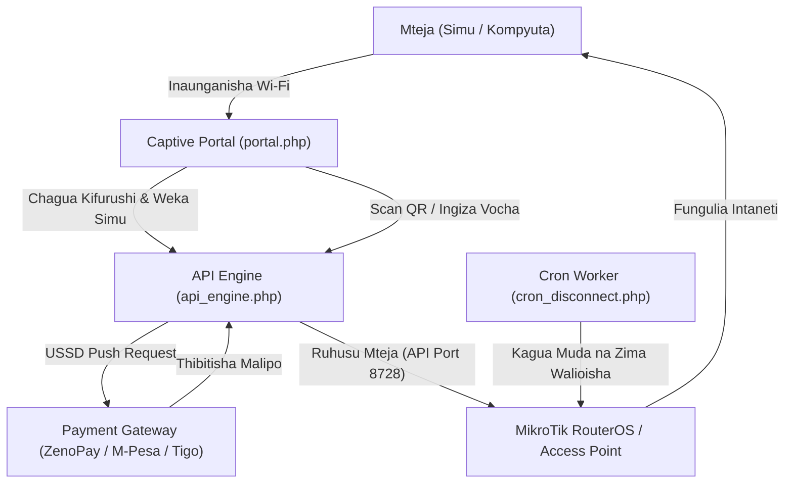

# 🌐 GLOW NET (V4) - Multi-Branch Wi-Fi Hotspot & ISP Billing System

[](https://php.net)
[](https://mysql.com)
[](https://mikrotik.com)
[](#)
[](LICENSE)

**GLOW NET** ni mfumo wa kisasa wa kusimamia na kuuza intaneti ya **Wi-Fi Hotspot** na **ISP Billing** unaowezesha ufuatiliaji wa vituo vingi (Multi-Branch), malipo ya kiotomatiki ya **Mobile Money ya Tanzania (M-Pesa, Tigo Pesa/Mixx, Airtel Money, Halopesa)** kupitia USSD Push, muunganisho wa moja kwa moja na **MikroTik RouterOS API (Port 8728)**, uchapishaji wa vocha (Thermal POS 58mm/80mm & A4), QR Code scanner, pamoja na ripoti za kina za fedha na grafu za mapato (Chart.js).

---

## 🚀 Sifa Kuu za Mfumo (Key Features)

### 1. 🏢 Multi-Branch & Station Management
* Usimamizi wa vituo vingi vilivyotawanyika (mf. Kimara, Mbezi, Sinza n.k.) kwenye seva moja.
* Kila kituo kina mmiliki wake anayejitegemea (Branch Owner Dashboard), router yake (IP/Port/Credentials), na bei zake za vifurushi.
* Mfumo wa ada ya mwezi ya vituo (**Branch Subscription**) na auto-renewal kupitia Mobile Money.

### 2. 📲 Malipo ya Moja kwa Moja ya Simu (USSD STK Push)
* Mteja akiweka namba yake ya simu, mfumo unatambua mtandao wake kiotomatiki (**Telco Auto-Detect**: Vodacom, Tigo, Airtel, Halotel).
* Ombi la malipo (USSD Push) linatumwa papo hapo kwenye simu ya mteja.
* Mara tu mteja anapoweka PIN yake, intaneti inawashwa kiotomatiki kwenye MikroTik bila kuingiza vocha wala kusubiri.

### 3. 📡 MikroTik RouterOS API & Hardware Gateway
* Muunganisho imara wa soketi kupitia **MikroTik RouterOS API (Port 8728/8729)** kwa v6 na v7.
* Auto-provisioning ya Hotspot User, ufungaji wa muda wa kikomo (`limit-uptime`), na mgawo wa spidi (`rate-limit` k.m. `5M/5M`).
* Kitufe cha kumtenga mtumiaji moja kwa moja (Kick User / Force Disconnect).
* Fallback salama: Kituo kikipoteza intaneti au mawasiliano, mfumo unashughulikia kwa usalama bila kukwamisha wateja.

### 4. 🖨️ Uchapishaji wa Vocha wa Aina Mbili (Dual Printing Modes)
* **Kadi za A4 (PDF / Print Grid)**: Vocha zikiwa zimepangwa vizuri zenye Serial Number, Kodi ya Vocha, na QR Code kwa ajili ya mauzo ya madukani.
* **Risiti za POS Thermal (58mm / 80mm)**: Muundo maalum wa risiti za haraka kwa printa za duka au mashine za mkononi za POS.

### 5. 📷 Scanner ya Vocha ya QR Code (Live Camera)
* Captive Portal inajumuisha scanner ya kamera inayosoma QR Code ya vocha moja kwa moja bila kuhitaji mteja kuandika herufi ndefu.

### 6. 📊 Ripoti za Kina za Fedha & Grafu za Mapato (Analytics & Charts)
* Dashibodi ya Master Admin inayoonyesha grafu ya mwenendo wa mauzo ya siku 7 kupitia **Chart.js**.
* Ripoti za fedha zilizoainishwa (Mauzo ya Simu, Vocha za Cash, na Ada za Matawi).
* Kitufe cha **Chapisha Ripoti (Print / Export PDF)** kwa ajili ya hesabu za kibiashara.

---

## 🏗️ Muundo wa Mtiririko wa Mfumo (Architecture Diagram)



---

## 📂 Mpangilio wa Mafaili (Project Structure)

```text
GLOW_NET/
├── index.php                # Ukurasa wa mwanzo na uzinduzi (Launchpad)
├── config.php               # Mipangilio mikuu ya database, auto-detect & auto-migration
├── config.example.php       # Mfano wa mipangilio salama bila kuweka siri zako wazi
├── .env.example             # Mfano wa vigezo vya mazingira (Environment variables)
├── .gitignore               # Orodha ya mafaili yanayozuiwa kupakiwa Git/GitHub
├── login.php                # Lango salama la kuingia (Admin & Branch Owners)
├── logout.php               # Kufunga session salama
├── dashboard.php            # Master Admin Control Center & Grafu za Mapato
├── branch_dashboard.php     # Dashibodi ya mmiliki wa tawi & Malipo ya Ada
├── portal.php               # Captive Portal ya wateja (Mobile Money & QR Scanner)
├── reports.php              # Ripoti kuu za fedha, takwimu na Print/PDF
├── print_vouchers.php       # Uchapishaji wa vocha (POS Thermal 58mm/80mm & A4)
├── api_engine.php           # Injini kuu ya AJAX na mawasiliano ya mfumo
├── PaymentGateway.php       # Uunganishaji wa Mobile Money ya Tanzania (ZenoPay)
├── RouterBridge.php         # Socket API ya MikroTik RouterOS na udhibiti wa vifaa
├── payment_webhook.php      # IPN / Webhook ya kupokea majibu ya malipo ya mtandaoni
├── cron_disconnect.php      # Daemon inayofanya kazi nyuma kusafisha sessions zilizoisha
├── glownet_db.sql           # Schema kamili ya Database ya MySQL
├── mikrotik_login.html      # Template ya faili la MikroTik Hotspot (login.html)
└── LICENSE                  # Leseni ya wazi ya MIT
```

---

## ⚙️ Mahitaji ya Mfumo (Requirements)

* **Web Server**: Apache au Nginx (k.m. XAMPP, WAMP, Laragon, au Linux Server).
* **PHP**: Toleo la `7.4` au `8.x` (ikiwa na viendelezi vya `pdo_mysql`, `curl`, na `sockets`).
* **Database**: MySQL `5.7+` au MariaDB `10.3+`.
* **Hardware**: MikroTik RouterBOARD yoyote (iliyo na RouterOS v6 au v7) au Access Point yoyote inayokubali Captive Portal.

---

## 🛠️ Jinsi ya Kufunga na Kuendesha (Installation Guide)

### 1. Pakua Mradi (Clone Repository)
Weka mradi kwenye folda ya seva yako (k.m. `htdocs/glownet` kwa watumiaji wa XAMPP):
```bash
git clone https://github.com/abishai-crypto/GLOW_NET.git
cd GLOW_NET
```

### 2. Sanidi Mipangilio ya Database & Seva
Mfumo una uwezo wa kugundua MySQL kiotomatiki kwenye bandari (port) ya **3306** au **3307** ya XAMPP na kutengeneza database kiotomatiki.

Ikiwa unataka kubinafsisha nenosiri au seva yako, tengeneza faili la `config.local.php` au nakili kutoka `config.example.php`:
```bash
cp config.example.php config.local.php
```

### 3. Washa MySQL na Apache
Fungua **XAMPP Control Panel** kisha ubonyeze kitufe cha **Start** kwenye:
* **Apache**
* **MySQL**

*(Database ya `glownet_db` pamoja na majedwali yake yote yatatengenezwa kiotomatiki mara tu unapoingia kwenye mfumo kwa mara ya kwanza).*

### 4. Fungua Kwenye Kivinjari (Browser)
Tembelea anwani zifuatazo:
* **Launchpad**: [http://localhost/glownet/index.php](http://localhost/glownet/index.php)
* **Lango la Kuingia (Login)**: [http://localhost/glownet/login.php](http://localhost/glownet/login.php)
* **Master Admin**: [http://localhost/glownet/dashboard.php](http://localhost/glownet/dashboard.php)
* **Ripoti za Fedha**: [http://localhost/glownet/reports.php](http://localhost/glownet/reports.php)

---

## 🔑 Akaunti za Majaribio (Default Credentials)

| Aina ya Akaunti | Jina la Mtumiaji / Kodi | Nenosiri (Password) | Ufikiaji (Access) |
|---|---|---|---|
| **Master Admin** | `admin` | `admin123` | Usimamizi mkuu wa vituo vyote, mapato, subscriptions & ripoti |
| **Kituo cha Kimara** | `GLOW-KIMARA` (au `0755111222`) | `1234` | Dashibodi ya Tawi, uundaji wa vocha, router settings & malipo ya ada |
| **Kituo cha Mbezi** | `GLOW-MBEZI` (au `0713333444`) | `1234` | Dashibodi ya Tawi la Mbezi |
| **Kituo cha Sinza** | `GLOW-SINZA` (au `0788555666`) | `1234` | Dashibodi ya Tawi la Sinza |

> ⚠️ **Muhimu wa Kiusalama**: Baada ya kufunga mfumo katika mazingira halisi ya kibiashara (Production), badilisha mara moja manenosiri haya chaguo-msingi kuwa imara.

---

## 📡 Mipangilio ya MikroTik Hotspot (MikroTik Configuration)

Ili kuruhusu wateja kulipia kabla hawajapata intaneti, ongeza maeneo yafuatayo kwenye **Walled Garden** ya MikroTik yako:

```routeros
/ip hotspot walled-garden
add dst-host=*glownet*
add dst-host=*zeno.africa*
add dst-host=*tailwindcss.com*
add dst-host=*cdnjs.cloudflare.com*

# Wezesha API Service (Port 8728)
/ip service enable api
/ip service set api port=8728
```

---

## ⏱️ Kuweka Background Cron Worker (Automated Disconnect)
Ili mfumo uzime wateja walioisha muda wao na kusimamisha vituo vilivyoisha ada ya mwezi, weka cron job kwenye seva yako inayojiendesha kila dakika 2:
```bash
*/2 * * * * curl -s http://localhost/glownet/cron_disconnect.php > /dev/null 2>&1
```

---

## 📄 Leseni (License)
Mradi huu unasambazwa chini ya leseni ya wazi ya **[MIT License](LICENSE)**. Una uhuru wa kuutumia, kuuboresha, na kuutumia kibiashara.

---

## 🤝 Mchango na Mawasiliano (Contributing)
Michango, marekebisho ya hitilafu, na maoni ya kuboresha mfumo huu yanakaribishwa sana:
1. Fork repository hii
2. Tengeneza branch yako ya mabadiliko (`git checkout -b feature/KipengeleKipya`)
3. Fanya Commit (`git commit -m 'Ongeza kipengele kipya cha malipo'`)
4. Push kwenye branch yako (`git push origin feature/KipengeleKipya`)
5. Fungua **Pull Request**
